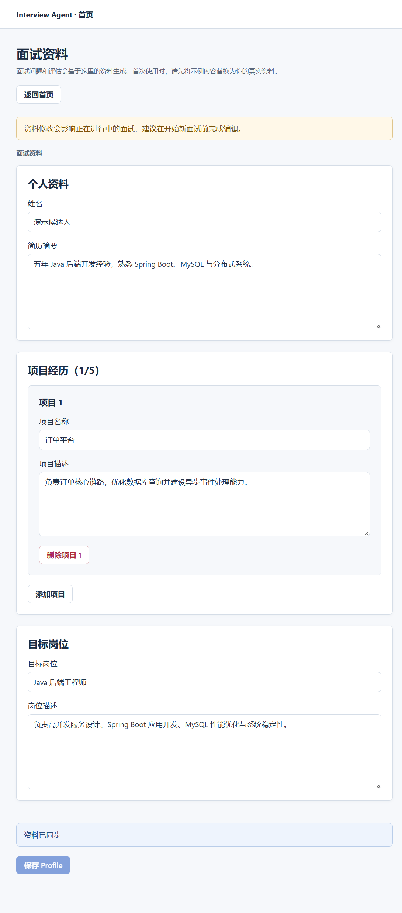
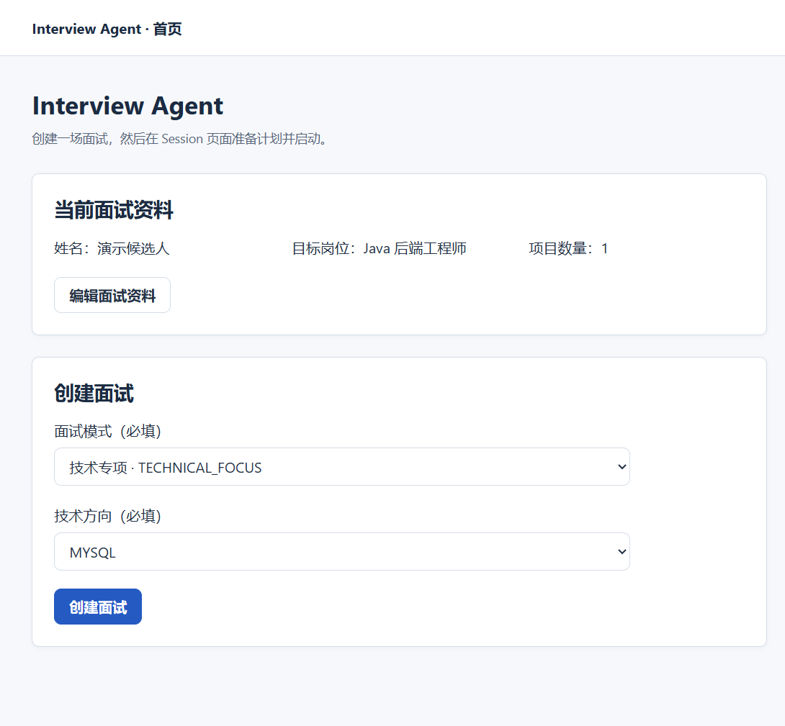
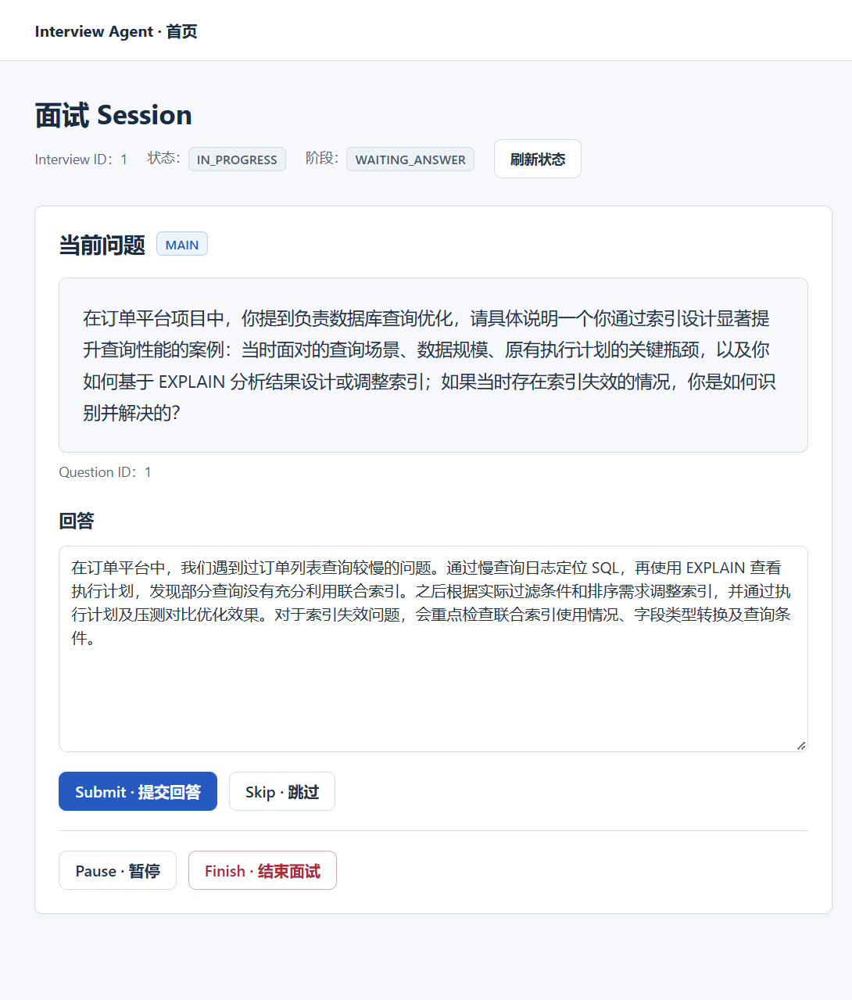
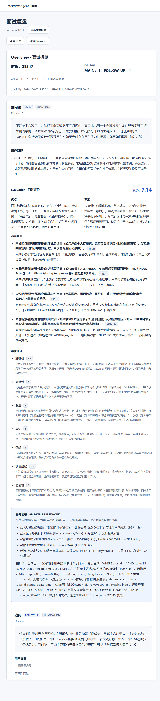

# Interview AI

面向程序员的 AI 面试训练系统，当前主要围绕 **Java 后端**场景，通过有计划的文本提问、动态追问、逐题评价与复盘，帮助练习技术表达和回答思路。

项目以 **single-user personal instance（单用户个人实例）**运行：在自己的实例中维护面试资料、选择训练方向并完成模拟面试。当前无登录认证、无多用户数据隔离，适合本地个人训练与 AI 应用工程实践，**不适合直接匿名公网开放**。

## Why Interview AI

面试训练不只是生成一组题目，还需要结合个人经历与目标岗位，把提问、回答、反馈和下一步选择连起来。

- **有计划地练习**：先生成 InterviewPlan，再围绕计划提出主问题，根据回答追问或进入下一题。
- **有依据地复盘**：提供维度评分、回答论据、优势、问题、遗漏点与参考回答，帮助定位表达和知识上的不足。
- **保留可靠的业务状态**：模型调用失败时保留已提交回答，从持久化事实重新执行本轮处理。

## Current Capabilities

| 能力 | 当前范围 |
| --- | --- |
| Personal Profile | 编辑候选人姓名、简历摘要、项目经历、目标岗位与岗位描述 |
| 面试准备 | Create → Prepare → Start；Prepare 生成并保存 InterviewPlan，成功准备后才能启动 |
| 文本面试 | MAIN 主问题、文本回答、逐题 Evaluation，以及动态 FOLLOW_UP / 下一题 / 结束 |
| 过程控制 | 跳过、暂停与恢复、主动结束、截止时间处理；可用操作由后端状态规则决定 |
| 失败恢复 | 可恢复 AI 失败的有限自动重试，以及符合恢复条件时的整轮手动重试 |
| 完成后 Review | 客观统计、MAIN / FOLLOW_UP 问题链、回答和逐题评价，基于已有事实只读聚合 |
| Web 界面 | 首页、Profile 编辑页、Interview Session 页和 Review 页；可用已知 Interview ID 再次访问 |

### InterviewMode

| 模式 | 用途 |
| --- | --- |
| `COMPREHENSIVE` · 综合面试 | 结合岗位要求与个人经历，在多个技术方向间进行训练 |
| `PROJECT_DEEP_DIVE` · 项目深挖 | 围绕项目经历练习技术决策、故障处理、性能优化与技术取舍；创建前至少需要一个项目 |
| `TECHNICAL_FOCUS` · 技术专项 | 聚焦一个指定的 KnowledgeArea |

技术专项可单选 Java、并发、JVM、MySQL、Redis、MQ、Spring、分布式系统或系统设计；其他两种模式不指定专项方向。项目为空时，仍可创建综合面试或合法的技术专项面试。问题数量与时长由服务端配置，界面不提供难度或时长选择。

### Personal Profile

通过首页的“编辑面试资料”进入 `/profile`，维护当前实例的一份资料：

| 资料 | 可编辑内容 |
| --- | --- |
| Candidate | 候选人姓名 |
| Resume | 简历摘要（文本） |
| Projects | 0–5 个项目的名称与描述，支持添加、修改和删除 |
| Position | 目标岗位名称与岗位描述 |

首次启动包含示例资料，建议先替换为自己的真实资料，再开始面试。多个项目会一起传入规划与模型上下文，当前没有单独选择目标项目的操作，也没有简历文件上传或解析。

**Profile 修改会影响进行中的 Interview。** 当前不冻结面试资料快照，也不阻止面试期间编辑；后续生成与评价可能使用更新后的资料，而已保存的 Plan、问题和评价仍保留原有事实。建议在开始新面试前完成资料编辑。

## Docker Compose Quick Start

从源码构建并启动 Frontend、Backend 和 MySQL。宿主机需要 Git、Docker Engine / Docker Compose，以及可访问镜像、Maven、npm 仓库和 DashScope 的网络；无需安装 JDK、Maven、Node 或 MySQL。

### 1. 获取源码

```bash
git clone https://github.com/linj6/interview-ai.git
cd interview-ai
```

### 2. 配置环境

复制根目录 `.env.example` 为 `.env`：

```powershell
# Windows PowerShell
Copy-Item .env.example .env
```

```bash
# Linux / macOS
cp .env.example .env
```

编辑 `.env`：

| 环境变量 | 配置 |
| --- | --- |
| `DB_PASSWORD` | 必填，设置应用数据库用户密码 |
| `MYSQL_ROOT_PASSWORD` | 必填，设置与应用用户不同的数据库 root 密码 |
| `AI_DASHSCOPE_API_KEY` | 必填，填写有效的 DashScope API Key |
| `AI_DASHSCOPE_CHAT_MODEL` | 默认 `qwen-plus` |
| `FRONTEND_PORT` | 默认 `8080`，端口冲突时更改 |

`.env` 已被 Git 忽略，不要提交其中的密码和 Key。Compose 固定数据库名和应用用户名为 `interview_agent`，使用内部数据库连接；示例中的 `DB_URL` / `DB_USERNAME` 仅供宿主本地启动，Compose 不使用它们。终端已有的同名环境变量优先于 `.env`；包含 `$` 或 `#` 的值建议用单引号包围。

### 3. 启动并训练

```bash
docker compose config --quiet
docker compose up --build -d
docker compose ps
```

首次构建需要下载依赖。三个服务健康后，打开 [http://localhost:8080](http://localhost:8080)（或配置的端口）：

1. 进入 Profile，将示例内容替换为个人资料并保存。
2. 返回首页，选择 InterviewMode；技术专项需选择一个方向，项目深挖需至少一个项目。
3. 创建面试，准备计划，再开始面试。
4. 提交文本回答，系统根据回答评价决定追问、进入下一题或结束；可按需跳过、暂停或主动结束，结束后查看 Review。

首次启动自动执行 Flyway Migration，并初始化示例资料和评价规则，无需手工导入 SQL。Compose 使用 `prod` 启用真实 LLM，准备、提问和回答处理会产生模型调用费用；健康检查不调用模型，也不能证明 API Key 有效。

仅 Frontend 发布宿主端口，默认映射为 `127.0.0.1:8080 → Nginx:80`。Backend 的 `8080` 与 MySQL 的 `3306` 仅用于容器网络内部访问。

```bash
# 查看后端日志
docker compose logs --tail 100 backend

# 停止并移除容器与网络，保留数据库数据
docker compose down

# 再次启动，继续使用原有数据
docker compose up -d
```

不要给停止命令添加 `--volumes`，除非明确要删除该实例的全部数据库数据。已有数据库 volume 不会因修改 `.env` 自动更新数据库用户密码，凭据变更须与现有数据库保持一致。

部署、数据管理与故障排查见 [Docker 部署指南](doc/00-project/docker-deployment.md)。本地开发、构建和测试见[开发指南](doc/00-project/development-guide.md)与 [Frontend README](frontend/README.md)。默认自动化测试不需要 LLM API Key，也不产生模型调用费用；真实模型 Smoke 需显式启用 `llm-smoke`。

## Demo Walkthrough

以下截图使用演示资料，展示 Docker Compose 独立 Demo 的主要流程：**Create → Prepare → Start → Submit → FOLLOW_UP → Finish → Review**。追问由系统根据本轮处理结果决定，并非每次提交都会触发。

### 1. 开始前完善 Profile

首次使用先通过“编辑面试资料”维护简历摘要、项目经历和目标岗位，再返回首页创建面试。资料修改会影响进行中的面试，建议在开始前保存。

<details>
<summary>查看 Profile 编辑页</summary>



</details>

### 2. 首页选择模式并创建面试

首页展示当前资料摘要；选择面试模式后创建面试。技术专项需指定一个方向，项目深挖需至少一个项目。



### 3. 准备计划、启动并回答

创建后进入 Session，先 Prepare 保存计划，再 Start 生成首题。Submit 提交文本回答后，系统生成评价并决定 FOLLOW_UP、下一道主问题或结束。截图展示主问题与待提交回答。



### 4. 结束后查看 Review

Finish 后进入只读复盘，查看统计、主问题与追问链、已提交回答和逐题评价。此示例包含一条已回答主问题及一条结束时未回答的追问；未回答题没有评价。Review 聚合已保存事实，不生成整场 AI 报告或整场综合分。

<details>
<summary>查看 Review 长截图（点击图片查看原图）</summary>

<a href="doc/images/interviews-review.png"></a>

</details>

## How It Works

```text
Personal Profile → 选择模式 → Create → Prepare → Start
                                        │         │
                                  InterviewPlan   MAIN
                                                  ↓
                                               提交回答
                                                  ↓
                                          Evaluation → Decision
                                                  ↓
                                      FOLLOW_UP / 下一道 MAIN / 结束
                                                  │             │
                                               继续回答        Review
```

- **InterviewPlan**：Prepare 保存计划及其 PlanItems，每项包含考察领域、方向和理由。Prepare 与 Start 是独立操作；计划准备成功后，用户再启动首题生成。
- **MAIN / FOLLOW_UP**：MAIN 使用计划项；FOLLOW_UP 围绕当前回答的待澄清点展开，关联所属 MAIN 并共享计划项，不额外消耗计划项。
- **Evaluation**：模型提供适用维度分数、评分说明、回答论据与反馈；Java 校验结构和规则，并用 `BigDecimal` 计算逐题加权总分。Reference Answer 提供参考回答或回答框架。
- **Review**：面试结束后，读取已保存的问题链、回答与评价进行复盘，不再次调用 LLM 生成整场报告。

## Architecture

系统采用 **Maven 多模块的模块化单体**，模块通过明确的 Public API 协作。前端通过同源 `/api` 访问后端，MySQL 保存权威业务事实。

```text
Vue Web UI → Nginx /api → Spring Boot
                              ├─ Candidate / Position：个人资料上下文
                              ├─ Interview：计划、问题、回答、生命周期与复盘
                              ├─ Evaluation：评价规则与正式评价持久化
                              └─ AI：规划、评价、决策与问题生成 → DashScope
                              ↓
                            MySQL
```

每轮先用短事务保存回答，再在数据库事务外完成 AI 调用，最后以短事务原子提交评价与下一题，或评价与面试结束状态。模型输出经过 Java 校验与业务规则检查后才能成为正式事实；状态条件、版本检查和唯一约束处理并发与重复提交。

AI Workflow 服务单次业务操作，不跨越用户等待阶段长期挂起。失败恢复从 MySQL 事实重建上下文并重跑完整 Turn；已保存回答保留。超时或断网后应先读取面试状态，再决定是否手动重试。

架构和模块边界见[总体架构](doc/02-architecture/architecture.md)、[模块结构](doc/02-architecture/module-structure.md)与 [ADR](doc/adr/)。

## Tech Stack

| 层面 | 技术 |
| --- | --- |
| Backend | Java 17、Spring Boot 3.5、Maven 多模块 |
| LLM | Spring AI、Spring AI Alibaba / DashScope，默认模型 `qwen-plus` |
| Persistence | MySQL 8.4（Compose）、MyBatis-Plus、Flyway |
| Frontend | Vue 3、TypeScript、Vue Router、Vite |
| Deployment | Docker Compose、Nginx |
| Verification | JUnit、Testcontainers、Spotless、前端 Node 测试与类型检查 |

## Documentation

| 入口 | 内容 |
| --- | --- |
| [Project Context](doc/PROJECT_CONTEXT.md) | 项目导航与状态摘要 |
| [Docker Deployment](doc/00-project/docker-deployment.md) | Compose 配置、启动、日志与数据管理 |
| [Development Guide](doc/00-project/development-guide.md) / [Frontend README](frontend/README.md) | 本地开发、测试与人工验证 |
| [Requirements](doc/01-requirements/requirements.md) | 功能需求与 HTTP Contract |
| [Architecture](doc/02-architecture/architecture.md) / [Module Structure](doc/02-architecture/module-structure.md) | 总体架构与模块边界 |
| [Domain Model](doc/02-architecture/domain-model.md) / [Data Model](doc/04-data/data-model.md) | 状态、计划、资料与持久化规则 |
| [AI Workflow](doc/03-ai/agent-design.md) / [Evaluator](doc/03-ai/evaluator-design.md) | AI 编排、结构校验与评分语义 |
| [Context](doc/03-ai/context-design.md) / [Prompt](doc/03-ai/prompt-design.md) | 输入上下文与提示词约束 |
| [ADR](doc/adr/) | 架构决策及原因 |

正式文档以 GitHub `main` 的 `doc/` 为准。部分文档仍保留较早的演示资料范围或设计状态描述；当前 Profile 能力以已合并实现及上述能力清单为准。原始愿景不代表当前已实现功能。

## Project Status

当前版本为 `0.1.0-SNAPSHOT`，处于 MVP 迭代与公开发布准备阶段。当前 main 已实现 Personal Profile、三种面试模式、InterviewPlan、文本面试闭环、过程控制和只读 Review。

Docker Compose 独立 Demo 已完成真实业务链路验证，覆盖 Create → Prepare → Start → Submit → FOLLOW_UP → Finish → Review，记录见 [Phase 3](doc/progress/phase-3.md#public-release-task-1demo-截图与-readme-集成2026-10-08)。这证明本次 Demo 链路可运行；LLM 的问题生成、追问、事实归因和评价质量仍具有概率性，需要持续验证。当前仍是 single-user personal instance（单用户个人实例），不代表公网生产服务已完成验证。

## Known Limitations

- **LLM 输出具有概率性**：相同输入可能产生不同结果，结构与业务校验不能证明语义正确。
- **InterviewPlan / grounding 只能改善质量**：计划、历史问题上下文和候选人事实约束用于减少重复、改善覆盖及事实归因，不能保证完全避免语义重复、覆盖偏差、误推断或补造经历与指标；使用者需要核对。
- **AI Evaluation / Reference Answer 仅用于训练辅助**：它们不是权威结论、能力认证或唯一标准答案，不应作为招聘筛选或录用决策依据。加权计算确定性不代表模型评价确定性。
- **Profile 可变**：修改 Profile 会影响进行中的 Interview；没有资料快照或版本冻结，已保存计划与后续使用的资料可能出现背景差异。
- **单用户访问边界**：没有登录认证或多用户数据隔离；不适合直接匿名公网开放，也不适合作为公网多用户服务使用。
- **功能范围有限**：当前仅文本交互与完整 JSON 响应，无简历上传/解析、语音/视频、Streaming/SSE、RAG、历史面试列表、能力趋势或整场 AI Report，也不提供整场综合分。

## License

本项目采用 [MIT License](LICENSE)。
